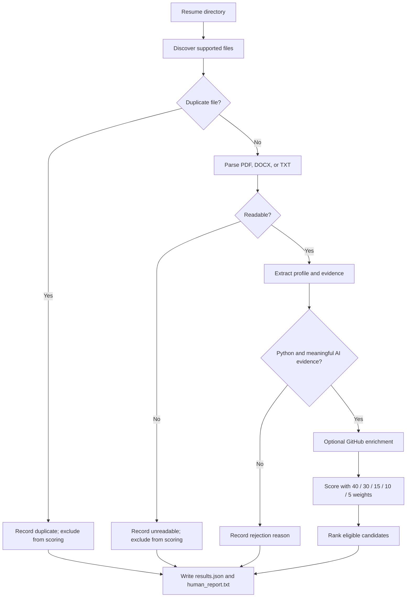

# Kasparro AI Resume Screening & Ranking System

## 1. Project overview
This project implements a Python-based batch resume screening system for the Kasparro SDE Intern AI Resume Screening assignment. It ingests resumes, extracts structured candidate signals, applies a deterministic hard eligibility filter, scores candidates using the required 100-point rubric, enriches GitHub activity when available, and produces both machine-readable JSON and a concise human-readable report.

## 2. Problem statement
The system must process a directory of resumes, handle malformed and unreadable files without stopping the batch, and rank eligible candidates by evidence-backed AI and Python implementation quality. The assignment requires a hard filter: candidates must show both genuine Python evidence and meaningful AI/LLM/RAG/agentic evidence.

## 3. Architecture
The architecture is intentionally simple and modular:

- src/ingestion: resume discovery, duplicate detection, batch processing
- src/parsing: text extraction for PDF/DOCX/TXT inputs
- src/extraction: candidate field extraction and evidence capture
- src/eligibility: hard filter logic
- src/scoring: weighted scoring, evidence strength, and explainability
- src/github: public GitHub enrichment and graceful failure handling
- src/llm: optional structured-output adapter behind a provider boundary
- src/reporting: human-readable ranking summary
- src/models: candidate dataclass and shared data structures

## 4. Setup instructions
1. Clone or open the project folder.
2. Create a virtual environment if desired.
3. Install dependencies:

   python -m pip install -r requirements.txt

4. Copy .env.example to .env and fill in optional keys.
5. Ensure your resume directory exists and contains PDF resumes.

## 5. Environment variables
The system is designed so the core logic does not require a secret key. Optional values may be provided in a .env file:

- OPENAI_API_KEY — optional LLM provider key
- MODEL_NAME — optional model name for a future structured LLM call
- GITHUB_TOKEN — optional personal access token for GitHub API requests
- RESUME_DIR — directory containing resumes
- OUTPUT_DIR — directory for JSON and report outputs

## 6. How to run
From the project root, use defaults or pass explicit input and output paths:

python main.py
python main.py --input ./resumes --output ./output/results.json

## 7. Output format
The pipeline writes:

- output/results.json: machine-readable ranked output and batch summary
- output/human_report.txt: concise human-readable ranking report

The JSON includes every resume. Eligible candidates are scored and ranked first; rejected candidates retain their source file, extracted evidence, and explicit rejection reasons without a score or rank. Duplicate and unreadable files are recorded as excluded without scoring.

## 8. Eligibility logic
A candidate is eligible only if both checks pass:

- Genuine Python evidence: Python skill or implementation plus backend/project/work evidence
- Meaningful AI evidence: RAG/retrieval/embeddings/vector search/agentic or LLM-oriented implementation evidence

JavaScript/Java/React/Next.js alone do not satisfy this filter.

## 9. Scoring methodology
The assignment requires the following weighting exactly:

- AI / Agentic / RAG Project Depth: 40
- Python & Backend Engineering: 30
- Cloud / Deployment / Full Stack: 15
- GitHub Activity: 10
- Engineering Depth Signals: 5

The total is capped at 100, and the score remains configurable through project settings while preserving the required weights.

## 10. AI Project Depth Detector
The AI depth detector distinguishes between:

- HIGH DEPTH: RAG, retrieval, embeddings, vector search, tool-calling, orchestration, evaluation, business logic
- MEDIUM DEPTH: meaningful LLM application with workflow/backend logic
- LOW DEPTH: wrapper or framework-only mentions with weak implementation evidence

This detector informs the AI score and the penalties applied for shallow LLM wrappers and framework-only claims.

## 11. Evidence-backed scoring
Each major score is supported by resume evidence rather than by brand names or keywords alone. The system records concrete project or internship evidence and uses it to justify the score breakdown and the final explainability summary.

## 12. GitHub enrichment
When a candidate includes a GitHub URL or profile, the system checks the public GitHub API for repositories pushed within the last 180 days and maintained, Python, and AI-related repositories. The score is capped at 10 (up to 5 for recent activity and 5 for repository signals). Missing or private GitHub profiles do not reject the candidate; they produce a graceful status and remain scored.

## 13. Error handling
The batch isolates failures to avoid stopping other candidates:

- corrupt or empty PDFs are caught and reported
- missing fields are tolerated
- GitHub rate limits and API failures are recorded without crashing the run
- duplicate resumes are tracked and ignored for ranking
- failed LLM calls are optional and non-blocking

## 14. Caching
The implementation includes versioned lightweight caching for GitHub enrichment. This reduces repeated network calls and invalidates scores when the scoring method changes.

## 15. Testing
The project includes focused tests covering the required passthrough cases, rejection logic, shallow wrapper penalties, duplicate handling, and score bounds.

Run tests with:

python -m pytest -q

## 16. Design Decisions
- Hard eligibility is deterministic to prevent subjective or noisy filtering from hand-wavy resume keywords.
- AI project depth is evidence-based instead of name-based, which keeps the score explainable and auditable.
- Shallow AI wrappers are penalized because they can appear to be AI work without actual implementation depth.
- GitHub is treated as an enrichment signal rather than a strict pass/fail criterion, as required by the assignment.
- Failures are isolated so batch processing remains reliable even when a single resume or service fails.
- LLM use is optional; provider-specific JSON output handling is isolated behind an adapter and is not required by the deterministic pipeline.

## 17. If I Had More Time
A few realistic improvements would be:

1. Add a stronger parser for more complex resume templates and multi-column PDFs.
2. Add a better project-section extractor for resumes with inconsistent headings.
3. Add optional OCR support for malformed scanned PDFs.
4. Add broader integration tests for unusual PDF layouts and external API limits.
